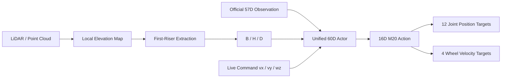

# M20 PRO 感知楼梯统一运动策略

> 当前迁移版本以 `interview_prep/model_35300.pt`（V11.1）为唯一分发基线，Actor 为 63D→16D。运行方法、依赖及未验证项见 [MIGRATION.md](docs/MIGRATION.md)。下文保留历史项目说明，其中的版本标记、验收结论和旧模型路径不能视为当前基线的验证结论。

## First-Riser Perception Guided Command-Conditioned Locomotion

基于 DeepRobotics M20 PRO 官方 Rough Locomotion，我们构建了一套统一的感知运动策略：局部感知负责解决“第一阶怎么过”，实时速度指令始终负责决定“机器人往哪里走”。

> **核心原则**
>
> Perception teaches the first riser; locomotion remains in charge of the robot.


---

## 1. 方法概览

系统不是在“平地策略”和“楼梯策略”之间切换，而是在同一个 Actor 中融合官方本体感觉、实时 command 和第一阶几何感知。



整体方法可写为：

$$
\text{First-Riser Perception}
\rightarrow
\text{Locomotion Handoff}
\rightarrow
\text{Command-Conditioned Locomotion}.
$$

感知层回答第一阶的局部几何问题，Locomotion 层持续执行用户给出的运动意图。

---

## 2. 官方 Command-Conditioned Locomotion 基础

官方 M20 Rough Policy 接收 57 维观测并输出 16 维动作：

$$
\mathbf{o}^{\mathrm{off}}_t \in \mathbb{R}^{57},
\qquad
\mathbf{a}_t \in \mathbb{R}^{16}.
$$

16 维动作保持 M20 官方定义：

$$
\mathbf{a}_t=
\left[
\mathbf{a}^{\mathrm{leg}}_t,
\mathbf{a}^{\mathrm{wheel}}_t
\right],
$$

其中

$$
\mathbf{a}^{\mathrm{leg}}_t \in \mathbb{R}^{12},
\qquad
\mathbf{a}^{\mathrm{wheel}}_t \in \mathbb{R}^{4}.
$$

官方 XY 速度跟踪奖励为

$$
r^v_t=
\exp\!\left(
-\frac{
\left\|
\mathbf{v}^{\mathrm{cmd}}_{xy,t}-
\mathbf{v}^{\mathrm{base}}_{xy,t}
\right\|_2^2
}{\sigma_v^2}
\right).
$$

因此，策略通过持续跟踪 $[v_x,v_y,\omega_z]$，并在姿态、接触、轮腿协调和平滑性约束下，自主形成适应复杂地形的运动方式。

---

## 3. 第一阶几何感知：B / H / D

我们没有把整张高程图直接输入 Actor，而是把第一阶跨越最关键的信息压缩为三个可部署变量：

$$
\mathbf{p}_t=[B_t,H_t,D_t].
$$

### 3.1 激活标志 B

$$
B_t\in\{0,1\}.
$$

$B_t=1$ 表示当前存在满足几何条件、需要处理的有效第一阶；否则为 0。

### 3.2 第一阶高度 H

$$
H_t=z_{\mathrm{upper},t}-z_{\mathrm{lower},t}.
$$

$z_{\mathrm{upper}}$ 与 $z_{\mathrm{lower}}$ 分别为第一阶上表面和下层地面高度。

### 3.3 第一阶距离 D

$$
D_t=
\left(
\mathbf{x}_{\mathrm{riser},t}-
\mathbf{x}_{\mathrm{robot},t}
\right)^{\!\top}
\mathbf{d}_{\mathrm{approach},t}.
$$

$\mathbf{d}_{\mathrm{approach}}$ 表示当前接近方向，$D_t$ 表示沿该方向到第一阶立面的纵向距离。

Actor 输入由官方 57D 扩展为统一 60D：

$$
\mathbf{o}_t=
\left[
\mathbf{o}^{\mathrm{off}}_t,
B_t,H_t,D_t
\right]
\in\mathbb{R}^{60}.
$$

---

## 4. Unified Actor

V10 Actor 保留官方动作空间，通过共享表示和 FR 几何分支实现感知辅助：

$$
\mathbf{h}_t=f_{\theta}\!\left(\mathbf{o}^{\mathrm{off}}_t,B_t\right),
$$

$$
\mathbf{a}^{\mathrm{support}}_t=g_s(\mathbf{h}_t),
$$

$$
\mathbf{a}^{\mathrm{FR}}_t=g_{\mathrm{FR}}\!\left(\mathbf{h}_t,H_t,D_t\right).
$$

最终动作仍为

$$
\mathbf{a}_t=
\left[
\mathbf{a}^{\mathrm{support}}_t,
\mathbf{a}^{\mathrm{FR}}_t
\right]
\in\mathbb{R}^{16}.
$$

其中，$B$ 进入 shared trunk，可以调制 whole-body action；$H/D$ 直接进入 FR 特殊分支，为第一阶跨越提供高度和距离信息。Action Manager、DelayedPD、关节定义和轮速控制形式保持不变。

### 4.1 PPO 策略与关节控制主流程（文字图）

```text
┌─────────────────────────────────────────────────────────────────────────────┐
│                     4096 Parallel IsaacLab Environments                    │
│                  24 control steps / environment / rollout                  │
└──────────────────────────────────┬──────────────────────────────────────────┘
                                   │
              ┌────────────────────┴────────────────────┐
              │                                         │
              ▼                                         ▼
┌──────────────────────────────┐          ┌──────────────────────────────────┐
│ Actor observation: 60D       │          │ Asymmetric critic input: 569D   │
│                              │          │                                  │
│ [ 0: 3] base angular velocity│          │ Official privileged obs: 247D  │
│ [ 3: 6] projected gravity    │          │ Clean PGTT map:          315D  │
│ [ 6: 9] command vx, vy, wz   │          │ Geometry truth:            3D  │
│ [ 9:25] joint position       │          │ Teacher labels:            4D  │
│ [25:41] joint velocity       │          └─────────────────┬────────────────┘
│ [41:57] previous action      │                            │
│ [57]    B                    │                            ▼
│ [58]    H                    │                     Value V_phi(s_t)
│ [59]    D                    │
└───────────────┬──────────────┘
                │
                ▼
┌─────────────────────────────────────────────────────────────────────────────┐
│ Unified Actor                                                              │
│                                                                             │
│ [official 57D + B] ──► Shared MLP: 58 → 512 → 256 → 128                    │
│                                      │                                      │
│                    ┌─────────────────┴─────────────────┐                    │
│                    ▼                                   ▼                    │
│          Support head: 128 → 13          FR head: [128 + H + D] → 128 → 3 │
│                    └─────────────────┬─────────────────┘                    │
│                                      ▼                                      │
│                    Gaussian policy pi_theta(a_t | o_t)                      │
│                         mean mu_theta, learned sigma                        │
└──────────────────────────────────────┬──────────────────────────────────────┘
                                       │ sample during training
                                       ▼
┌────────────────────────────── 16D ACTION ───────────────────────────────────┐
│                                                                             │
│                           FRONT / robot +X                                  │
│                                                                             │
│       FL: [0] hipx  [1] hipy  [2] knee     FR: [3] hipx  [4] hipy  [5] knee│
│           [12] wheel                             [13] wheel                  │
│                                                   ▲                         │
│                                              H / D direct path              │
│                                                                             │
│       HL: [6] hipx  [7] hipy  [8] knee     HR: [9] hipx [10] hipy [11] knee│
│           [14] wheel                             [15] wheel                  │
│                                                                             │
│                            REAR / robot -X                                  │
└──────────────────────────────────────┬──────────────────────────────────────┘
                                       │
                                       ▼
┌─────────────────────────────────────────────────────────────────────────────┐
│ Action Manager → DelayedPD → M20 dynamics                                  │
│                                                                             │
│ hipx position target: q_target = q_default + 0.125 a_i                      │
│ hipy/knee target:     q_target = q_default + 0.250 a_i                      │
│ wheel velocity target: omega_target = 5.0 a_i                              │
└──────────────────────────────────────┬──────────────────────────────────────┘
                                       │
                                       ▼
                        reward r_t, done d_t, next state
                                       │
                                       ▼
┌─────────────────────────────────────────────────────────────────────────────┐
│ Rollout Buffer: 4096 × 24 = 98,304 transitions / PPO iteration             │
│                                                                             │
│ TD residual → GAE (gamma = 0.99, lambda = 0.95)                             │
│ → normalized advantage                                                     │
│ → PPO clipped objective (epsilon = 0.20)                                   │
│ → 5 learning epochs × 4 mini-batches                                       │
│ → update Actor theta, Critic phi and action log standard deviation         │
└──────────────────────────────────────┬──────────────────────────────────────┘
                                       │
                                       └──────────────► next rollout
```

---

## 5. 第一阶学习信号

第一阶感知奖励由成功事件、净空进度和 MISS 事件组成：

$$
r^{\mathrm{perception}}_t=
w_f I^{\mathrm{FIRST}}_t+w_c\Delta C_t-w_m I^{\mathrm{MISS}}_t.
$$

Clearance 使用历史最大进度：

$$
\Delta C_t=\max\!\left(0,C_t-C^{\max}_{t-1}\right),
$$

$$
C^{\max}_t=\max\!\left(C^{\max}_{t-1},C_t\right).
$$

因此，只有创造新的净空进展才获得奖励；重复抬落或回到已经达到的位置不会重复领取相同进度奖励。

当前事件脉冲经过 control step $\Delta t=0.02\,\mathrm{s}$ 后为：

| Reward term | 配置权重 | 实际事件贡献 |
|---|---:|---:|
| `first_step_success` | `+41.2426414` | `+0.824852828` |
| `perception_miss` | `-41.2426414` | `-0.824852828` |
| `fr_clearance_progress` | `+2.0` | 与新增净空进度成正比 |
| `joint_success` | `+1649.705658` | 约 `+32.9941` |

FIRST 与 MISS 保持同一数量级，使局部感知教学信号保持对称。

第一阶几何表达已在固定楼梯测试中完成验证：

| 楼梯高度 | 完整通过结果 |
|---:|---:|
| 17 cm | 5 / 5 |
| 18 cm | 5 / 5 |

这验证了 $B/H/D$ 能够为第一阶提前抬升与跨越提供有效几何条件。

---

## 6. Perception-to-Locomotion Handoff

FIRST 成功后定义 episode-level handoff latch：

$$
L_t=
\begin{cases}
0, & \text{FIRST 之前},\\
1, & \text{FIRST 之后}.
\end{cases}
$$

Handoff 奖励复用官方实时 XY velocity tracking：

$$
r^{\mathrm{handoff}}_t=L_t\,w_h\,r^v_t.
$$

当前官方速度跟踪权重与额外 handoff 权重均为 5：

$$
w_v=5,
\qquad
w_h=5.
$$

因此

$$
r^{\mathrm{velocity}}_t=
\begin{cases}
5r^v_t, & L_t=0,\\
10r^v_t, & L_t=1.
\end{cases}
$$

该 handoff：

- 跟随实时 command $[v_x,v_y]$；
- 不依赖 $B$；
- 不依赖 first-riser rearm；
- 不使用 frozen target direction；
- FIRST 后保持到 episode reset。

这保证第一阶完成后，机器人整体运动意图继续由实时 command 决定：前进指令对应前进，零指令对应停止，后退指令对应后退。

---

## 7. 最终 Reward 职责划分

整体 reward 写为

$$
r_t=
r^{\mathrm{official}}_t+r^{\mathrm{first}}_t+r^{\mathrm{clearance}}_t
+r^{\mathrm{miss}}_t+r^{\mathrm{handoff}}_t+r^{\mathrm{completion}}_t.
$$

| Reward group | 职责 |
|---|---|
| $r^{\mathrm{official}}$ | 始终承担整体 locomotion 主任务 |
| $r^{\mathrm{first}}$ | 教会第一阶成功事件 |
| $r^{\mathrm{clearance}}$ | 提供连续的第一阶净空学习信号 |
| $r^{\mathrm{miss}}$ | 标记第一阶感知处理失败 |
| $r^{\mathrm{handoff}}$ | FIRST 后强化实时 command following |
| $r^{\mathrm{completion}}$ | 稀疏完整通过信号 |

对应的 PPO Return 为

$$
G_t=\sum_{k=0}^{\infty}\gamma^k r_{t+k}.
$$

通过约束局部事件奖励的数值尺度，最终优化关系保持为：

$$
\boxed{\text{Official Locomotion is the primary objective}}
$$

---

## 8. Reward Balance Audit

在 4096 个环境、984 control steps、PPO horizon 24、seed 42 的真实 rollout 中，得到以下账单：

| 分组 | 累计 Reward | Sample variance | Absolute-mass share |
|---|---:|---:|---:|
| Official total | `+47633.2262` | `0.0106423` | `45.2463%` |
| FIRST（18 次） | `+14.8474` | `0.0000152` | `0.0107%` |
| MISS（121 次） | `-99.8072` | `0.0001021` | `0.0722%` |
| Clearance | `+271.5506` | `0.0001859` | `0.1965%` |
| Post-FIRST tracking | `+293.8245` | `0.0000276` | `0.2126%` |
| FULL / Joint（1 次） | `+32.9941` | `0.0013508` | `0.0239%` |
| V10-added total | `+513.4094` | `0.0017547` | `0.5146%` |

Signed return 中：

$$
\mathrm{Share}_{\mathrm{official}}\approx98.93\%,
\qquad
\mathrm{Share}_{\mathrm{V10-added}}\approx1.07\%.
$$

MISS variance 相对 V10-added variance 的比例为

$$
\frac{\mathrm{Var}(r^{\mathrm{MISS}})}
{\mathrm{Var}(r^{\mathrm{V10-added}})}
\approx5.82\%.
$$

运行时审计结果：

```text
REWARD_BALANCE_AUDIT=PASS
POST_FIRST_RUNTIME_CONTRACT=PASS
```

完整账单位于 [`docs/v10_reward_audit_symmetric_miss_seed42/`](docs/v10_reward_audit_symmetric_miss_seed42/)。

---

## 9. Sim-to-Real 接口

真实机器人链路为：

```text
LiDAR
  → Local Point Cloud / Elevation Map
  → First-Riser Geometry Extraction
  → B / H / D
  → Unified 60D Actor
  → 16D M20 Action
```

$B/H/D$ 全部由真实 LiDAR 高程数据和机器人坐标系在线计算，不进入仿真专有 teacher label。仿真与真机保持一致的 Actor interface：

$$
\mathbf{o}_t=
\left[
\mathbf{o}^{\mathrm{off}}_t,B_t,H_t,D_t
\right]
\in\mathbb{R}^{60}.
$$

---

## 10. 代码入口

| 模块 | 路径 |
|---|---|
| V10 环境与 reward 配置 | `source/rl_training/rl_training/tasks/manager_based/locomotion/velocity/config/wheeled/deeprobotics_m20/v10_unified_env_cfg.py` |
| FIRST lifecycle、事件与统计 | `source/rl_training/rl_training/tasks/manager_based/locomotion/velocity/mdp/v10_unified.py` |
| 60D Unified Actor | `source/rl_training/rl_training/v10_unified_policy.py` |
| PPO runner 与 TensorBoard 指标 | `source/rl_training/rl_training/v10_unified_runner.py` |
| Reward balance audit | `scripts/tools/audit_m20_v10_reward_balance.py` |

训练任务 ID：

```text
M20-Stair-Unified-Perceptive-v0
```

从零训练 60K：

```bash
source /home/ubuntu/.holosoma_deps/miniconda3/bin/activate /home/ubuntu/.holosoma_deps/miniconda3/envs/hssim
TERM=xterm PYTHONPATH="$PWD/source/rl_training" /home/ubuntu/.holosoma_deps/IsaacLab/isaaclab.sh -p \
  scripts/reinforcement_learning/rsl_rl/train.py \
  --task M20-Stair-Unified-Perceptive-v0 \
  --num_envs 4096 \
  --max_iterations 60000 \
  --headless \
  --run_name v10_first_miss_symmetric_postxy_from_scratch_60k
```

---

## 11. 环境与安装

- Ubuntu 24.04
- Python 3.11
- Isaac Sim 5.1.0
- Isaac Lab 2.3.2
- RSL-RL 5.0.1
- DeepRobotics M20 PRO

```bash
git clone --recurse-submodules https://arcusgit.vip.cpolar.cn/arcus/kunyu_ppo.git
cd kunyu_ppo
python -m pip install -e source/rl_training
```

---

## 12. 一句话总结

> 本项目将局部第一阶感知与官方 Command-Conditioned Locomotion 放入同一套 PPO Policy：感知教会机器人如何跨越第一阶，而实时 command 始终掌握整机运动方向。

$$
\boxed{
\text{Perception Assistance}
+
\text{Live Command}
+
\text{Official Locomotion}
}
$$
